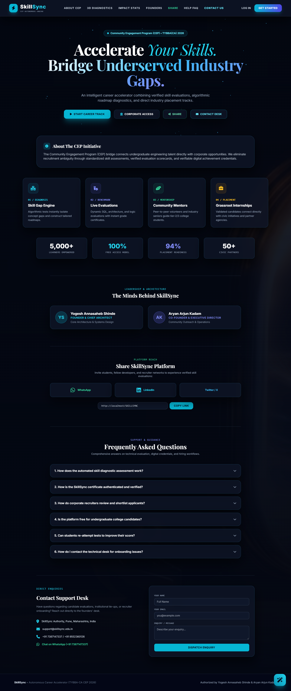
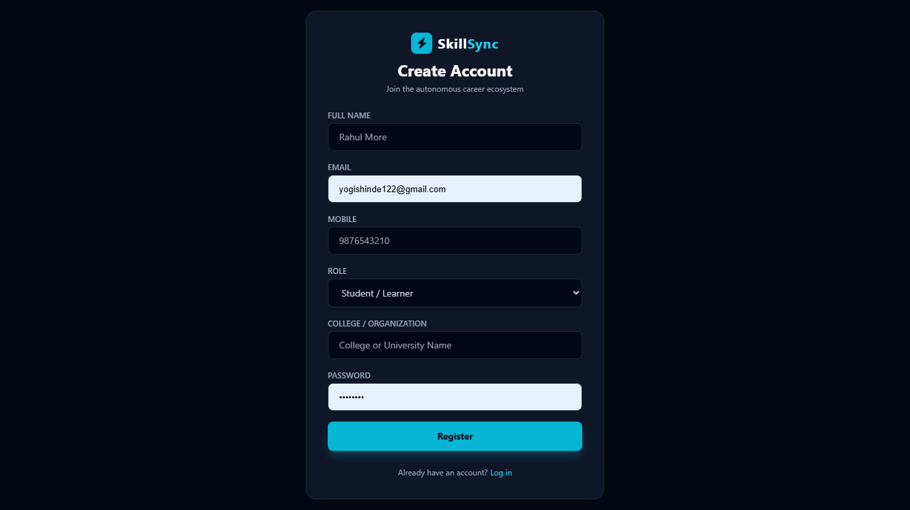
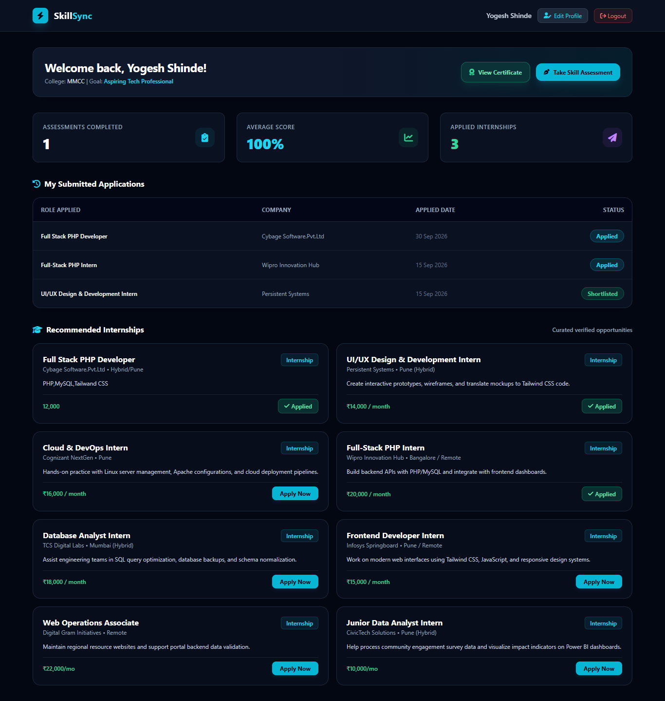
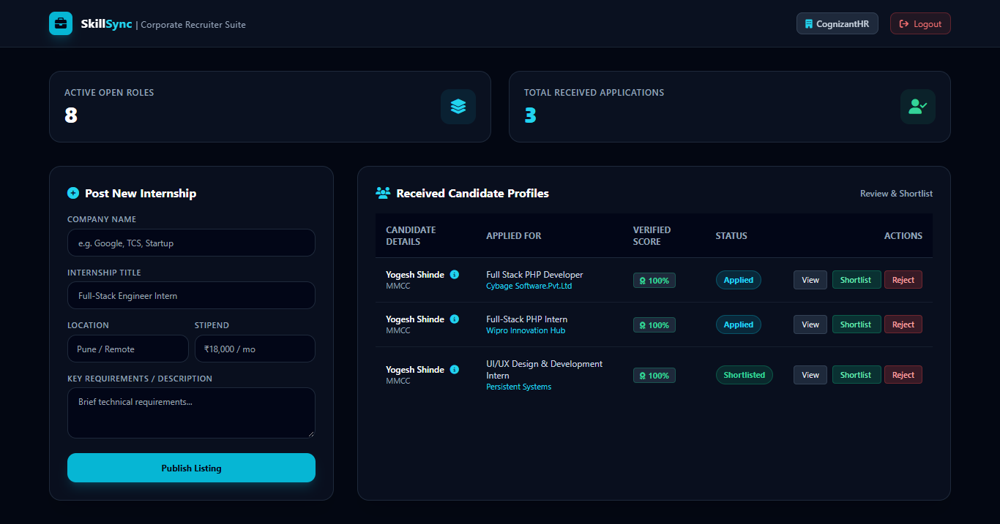
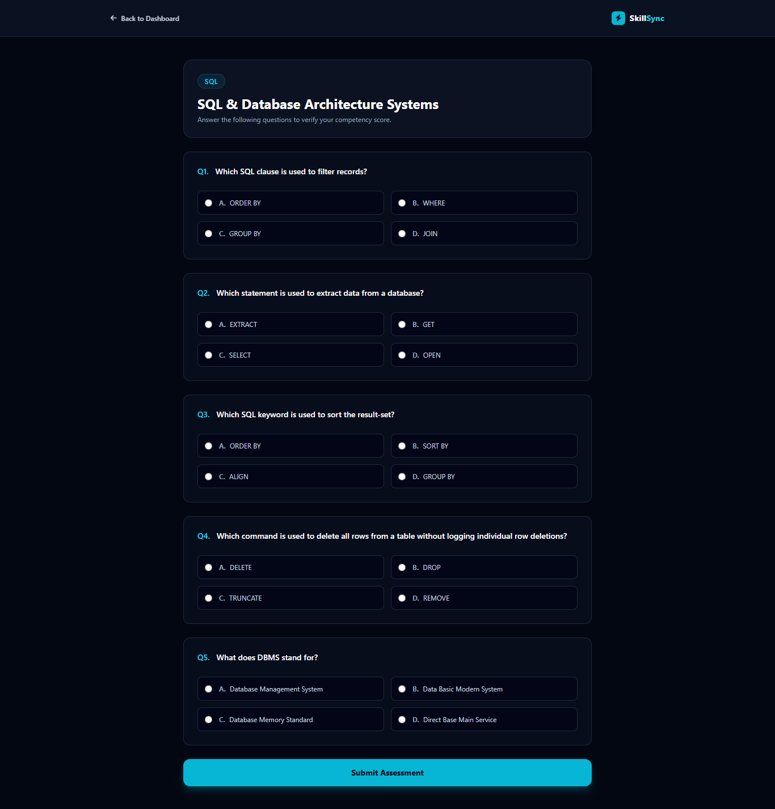

SkillSync – Smart Skill Matching & Talent Exchange Platform

SkillSync is a PHP and MySQL-based web platform designed to connect students, skilled individuals, and companies. It aims to simplify skill discovery, talent matching, and career opportunities.

🚀 Features

- User Registration and Login
- Student Dashboard
- Company Dashboard
- Student Profile Management
- Job / Opportunity Applications
- Skill Assessments
- Certificate Management
- Chat API Integration

🛠️ Tech Stack

- Frontend: HTML, CSS, JavaScript
- Backend: PHP
- Database: MySQL
- Development Tool: Visual Studio Code
- Local Server: XAMPP

📁 Project Structure

- "auth/" – Login, Logout and Registration
- "company/" – Company Dashboard
- "db.example.php" – Template for the database configuration
- "student/" – Student Dashboard, Profile, Applications, Assessments and Certificates
- "api_chat.php" – Chat API endpoint
- "index.php" – Main entry point

⚙️ Installation

1. Install XAMPP.
2. Clone or download this repository.
3. Place the project inside the "htdocs" folder.
4. Create a MySQL database.
5. Copy "db.example.php" to "config/db.php" (create the "config" folder) and enter your own database credentials.
6. Start Apache and MySQL from XAMPP.
7. Open the project in your browser using "http://localhost/SkillSync/".

📸 Screenshots

| | |
|---|---|
|  |  |
|  |  |
|  | |

🎯 Project Objective

To create a platform that helps students showcase their skills, connect with companies, and explore career opportunities.

👨‍💻 Developed As

College Project – TYBBA(CA)

SkillSync – Connecting Skills with Opportunities.